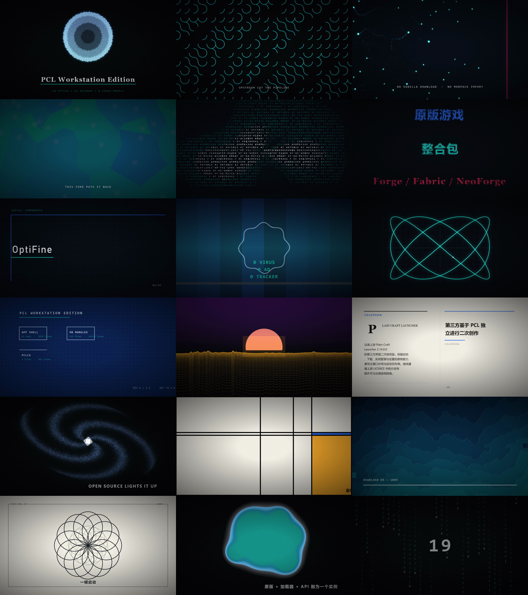

# code-video

**一个把"我想给我的项目做个宣传片"变成一条命令的 Skill。**

它会先问你几个问题，摸清你要讲什么、给谁看、只让观众记住哪一句，然后真的把片子渲染出来——每一帧都是 numpy 数组算出来的，配乐也是程序合成的。没有视频生成模型，没有素材库，没有版权问题。

```
你：用 code-video 给我的项目做个宣传片
它：这个视频主要投在哪里？（一次只问一个问题）
你：B 站
它：受众主要是开发者还是普通用户？
...
它：（16 分钟后）成片已生成，61 秒 1080p60，已推到你的 GitHub
```

## 为什么不用模板/剪辑软件

模板的问题是：**片子长得像模板**。观众一眼就看出这是 Canva 或者剪映的某个转场。

这个 Skill 走另一条路：画面是数学。

- 黄金角排列、Truchet 编织、向量场、Voronoi、ASCII 终端、半调网点、瑞士栅格、CRT 信号、万花筒、利萨如图形、工程蓝图、线框地形、杂志跨页、旋涡星系、蒙德里安切割、像素排序、玫瑰线、meta-ball、代码雨——**19 种完全不同的世界**
- 每一幕都由 `render(ctx) -> np.ndarray` 现场算出来，通过管道直送 ffmpeg
- 配乐是正弦/三角/锯齿/方波振荡器 + ADSR 包络 + 滤波噪声 + 软削波，没有一段采样
- 同一个 seed 必然复现同一个视频

## 核心设计：时间轴不是写死的

这是它和"模板视频生成器"的根本区别。

`engine/brief.py` 里有一张 **style deck**，每种风格声明自己能承载什么语义：

```python
{"style": "blueprint", "beat": "architecture",
 "tags": ["architecture", "structure", "design", "engineering", "modules"],
 "payload": {"title": "{title}", "sheet": "{sheet}", "modules": "{modules}"}}
```

访谈产出的 `brief.json` 只是一串叙事节拍：

```json
{"role": "problem", "headline": "用户下载要等 30 分钟", "tags": ["problem", "loss"]}
```

生成器按 `role`/`tags` 给每一拍挑一种**尚未用过**的风格，按 `weight` 分配时长，再把 brief 里的字段填进该风格的载荷模板。**换任何项目、任何主题，引擎代码一行不动。**

同一份 brief 还生成 `prompt.md`——所以提示词文档和实际视频永远同源，不会漂移。

## 快速开始

```bash
git clone https://github.com/G2-Fuej/code-video-skill
cd code-video-skill
pip install numpy opencv-python pillow imageio-ffmpeg
```

### 用自己的项目生成

```bash
python - <<'EOF'
import sys; sys.path.insert(0, "engine")
import brief, director

my_brief = {
    "title": "My Project",
    "duration": 30.0,
    "palette": {"primary": "#2563EB", "accent": "#14B8A6"},
    "beats": [
        {"role": "title",   "headline": "MY PROJECT"},
        {"role": "problem", "headline": "IT WAS SLOW"},
        {"role": "repair",  "headline": "NOW IT IS FAST"},
        {"role": "payoff",  "headline": "SHIP IT", "payoff": "GO"},
    ],
    "endcard_lines": [["built in code", "display_b", 46]],
}

problems = brief.validate(my_brief)
if problems:
    raise SystemExit("\n".join(problems))

spec = brief.build_spec(my_brief)
director.render(spec, "my-video.mp4")
EOF
```

`role` 和 `tags` 决定匹配哪种视觉风格，完整对照见 [`references/style-deck.md`](references/style-deck.md)。

### 在 AI 对话里用

把 `code-video` 目录放进你的 skills 目录，然后说：

> 用 code-video 给我的项目做个宣传片

它会按 [`references/interview-playbook.md`](references/interview-playbook.md) 的流程一次问一个问题，通常 6-8 题就够。

### 复现演示片

```bash
python scripts/render_pcl.py              # 完整 1080p60，约 16 分钟（32 核）
python scripts/render_pcl.py --preview    # 720p30 快速检查
python scripts/render_pcl.py --check-only # 只生成 spec 和 prompt，不渲染
python scripts/check_styles.py            # 19 种风格各出一帧联排图
```

## 19 种风格

| # | 风格 | 画面 | 适合承载 |
|---|------|------|----------|
| 01 | Phyllotaxis | 2600 颗葵花籽按黄金角排成花盘 | 开场、项目名 |
| 02 | Truchet | 编织弧线铺满画面，一块块被抽走 | 背景、机制 |
| 03 | Flow Field | 7000 粒子顺流场前进，撞上红墙 | 痛点、阻碍 |
| 04 | Voronoi | 玻璃碎片炸开再重组 | 修复、恢复 |
| 05 | ASCII | 环面纽结由字符密度勾勒 | 命令行、自证 |
| 06 | Halftone | 三块油墨网点错位套印 | 功能三栏 |
| 07 | Swiss Grid | 瑞士栅格，标题逐拍改写 | 组件、选项 |
| 08 | CRT | 扫描线 + 色散 + 荧光余晖 | 安全声明 |
| 09 | Kaleidoscope | 万花筒径向对称 | 生态、资源库 |
| 10 | Oscilloscope XY | 利萨如图形在示波器上画出来 | 流程、闭环 |
| 11 | Blueprint | 工程蓝图，模块框与引线 | 架构、结构 |
| 12 | Terrain | 数据分布变成线框地形 | 规模、体量 |
| 13 | Editorial | 杂志跨页，首字下沉 + 引文 | 许可、署名 |
| 14 | Galaxy | 46000 颗星旋成四臂星系 | 社区、开源 |
| 15 | De Stijl | 蒙德里安式切割 | 版式重构 |
| 16 | PixelSort | 像素垂直排序 + 进度条 | 进度、性能 |
| 17 | Plotter | 玫瑰线由绘图仪逐笔画出 | 一键操作 |
| 18 | Metaballs | 三个圆融成一个整体 | 融合、集成 |
| 19 | Matrix | 代码雨汇聚成一个短词 | 收尾、行动号召 |

## 结构

```text
SKILL.md                 # 访谈流程 + 铁律 + 质量门槛
engine/
  core.py                # 调色板、混合、噪声、批量线段、颗粒、暗角
  typekit.py             # 文字光栅化、字距、自动缩排、CJK 字体回退
  stage.py               # Scene 基类与 Ctx 渲染上下文
  scenes_a.py            # 前 7 幕
  scenes_b.py            # 后 12 幕 + 片尾卡
  score.py               # 程序化配乐（振荡器 + 包络，无采样）
  brief.py               # brief -> 时间轴（style deck 匹配 + 时长分配 + 校验）
  director.py            # 逐帧渲染，raw RGB 管道直送 ffmpeg
scripts/
  render_pcl.py          # 演示片完整 brief
  check_styles.py        # 19 种风格联排检查
  smoke.py               # 4 秒管线自检
  publish.py             # 发布到 GitHub
references/
  style-deck.md          # 19 种风格的语义分工与载荷格式
  brief-schema.md        # brief 字段完整说明
  interview-playbook.md  # 一次一题怎么问
  quickstart.md          # 从零跑通一次
```

## 质量保证

- **`check_styles.py`**：19 种风格全部渲染，断言无空帧、无 NaN、无扁平帧
- **`fit_mask`**：任何语言的任何长度文字自动缩排，不会溢出画幅
- **CJK 字体回退**：Bahnschrift/Consolas 等无中文字形的字体自动退到微软雅黑，不会出豆腐块
- **`brief.validate()`**：渲染前检查片长、节拍、风格重复、配色、数据字段——省下 16 分钟的无效渲染
- **ffprobe 自检**：分辨率、帧率、精确时长、音轨存在

## 演示片规格

内置演示是为 [PCL Workstation Edition](https://github.com/G2-Fuej/PCL-Workstation-Edition) 做的，用来验证完整链路：

```text
分辨率   1920 × 1080
帧率     60 fps
时长     61.000 s (3660 帧)
编码     H.264 High, yuv420p, crf 17, +faststart
音频     AAC 44.1kHz mono 192kbps
文件     约 52 MB
渲染     16 分 40 秒 · 32 核 · 纯 CPU
```

[](PCL-Workstation-Edition-61s.mp4)

> 演示片内容基于 [Plain Craft Launcher](https://github.com/Meloong-Git/PCL)，原作者 **龙腾猫跃（LTCat）**。这个 Skill 本身与 PCL 无关，只是用它当一个真实案例。

## 许可

MIT。字体使用操作系统自带字体（微软雅黑 / Bahnschrift / Consolas / Georgia），不随仓库分发。